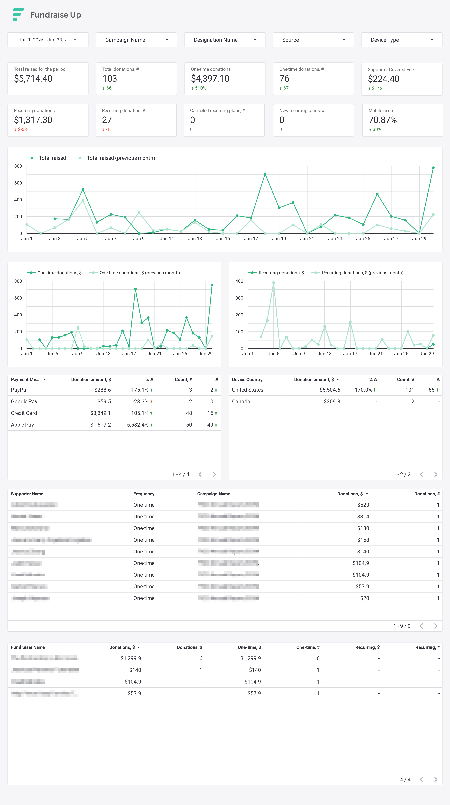

# Fundraise Up REST API - Data Studio Connector

A [community connector](https://developers.google.com/data-studio/connector) for Fundraise Up donations, powered by Google Apps Script. Connect directly to the REST API without a server or Google Sheets, or optionally export donations to Sheets on a schedule.

[API documentation](https://fundraiseup.com/docs/rest-api/) · [GetDonations reference](https://api.fundraiseup.com/v1/docs/#/operations/GetDonations)

## Usage

### Connect directly in Data Studio

1. In the [Fundraise Up Dashboard](https://dashboard.fundraiseup.com/), open **Settings > API keys** and create a key with donations read access for live or test data.
2. [Open the Fundraise Up connector](https://datastudio.google.com/datasources/create?connectorId=AKfycby0bbeMgpdU8Z8u3ORbbmDS4U4huWbOBTVZwjCxAfNbAy69e-HPLdVcf3CrokmPirrU).
3. Authorize Apps Script if prompted. This Google permission allows external API requests.
4. Enter **API Key**. **Test data** unchecked means live donations (`livemode=true`); checked means test donations (`livemode=false`).
5. Click **Connect** and add the source to a report. Date ranges filter donation creation dates in UTC.

Create a separate data source for each API key. Keys are stored in connection settings and visible to people who can edit them.

### Set up your own Apps Script project

1. Create an [Apps Script](https://script.google.com/) project and copy all root `.gs` files into it, or upload them with clasp.
2. In Project Settings, enable **Show appsscript.json manifest file in editor** and copy this repository's manifest into it.
3. Save, open **Deploy > Test deployments**, and copy the Head Deployment ID.
4. Open `https://datastudio.google.com/datasources/create?connectorId=YOUR_DEPLOYMENT_ID` with that ID.

Use the deployment ID in the connector link. For shared releases, create a [versioned deployment](https://developers.google.com/data-studio/connector/deploy).

### Export to Google Sheets

In your own Apps Script project's `appsscript.json`, set `oauthScopes` to:

```json
[
  "https://www.googleapis.com/auth/script.external_request",
  "https://www.googleapis.com/auth/spreadsheets",
  "https://www.googleapis.com/auth/script.scriptapp"
]
```

The supplied manifest includes only external API access. Sheets also needs [spreadsheet access](https://developers.google.com/apps-script/reference/spreadsheet/spreadsheet-app#openbyidid) and [trigger permissions](https://developers.google.com/apps-script/reference/script/script-app#newtriggerfunctionname).

1. Create an empty [Google spreadsheet](https://docs.google.com/spreadsheets/) and copy its ID from the URL.
2. Under **Project Settings > Script Properties**, add `SPREADSHEET_CONFIGS`:

   ```json
   [
     {
       "spreadsheet_id": "YOUR_SPREADSHEET_ID",
       "sheet_name": "Donations",
       "api_key": "YOUR_API_KEY",
       "livemode": true
     }
   ]
   ```

3. Run `runScheduledTask` once and grant permissions.
4. Under **Triggers > Add Trigger**, schedule `runScheduledTask` with a time-driven trigger.
5. Optionally connect the spreadsheet to Data Studio using Google's Sheets connector.

Add configuration objects for more accounts or sheets; use `livemode: false` for test data. Keep API keys in Script Properties, outside source files.

The first run backfills history, using continuation triggers for larger exports. Later runs append new donations and preserve dynamic columns. Existing rows are not refreshed: changed statuses and new fields on older donations require a fresh export.

## Schema

[_Schema.gs](_Schema.gs) defines **143 base fields**: 139 scalar API fields, two JSON arrays and two calculated fields.

- **Custom fields:** text columns with stable identifiers; values such as `001` stay text.
- **Questions:** columns by question ID and property (`code`, `text`, `checked`, `options`). Checkboxes remain boolean; selected options use a JSON array in one cell.
- **Custom Fields JSON / Questions JSON:** complete arrays, including entries not yet discovered as columns.
- **Next Installment at:** `recurring_plan.next_installment_at`.
- **Frequency:** `One-time`, `First installment`, or `Recurring`. **Recurring Plan Frequency** holds the interval, such as `monthly`.

Initial discovery samples up to 500 donations; later downloads add field definitions to a temporary cache. Refresh source fields after loading previously unseen fields. JSON columns preserve all entries even when initial discovery misses them. Sheets discovers columns from each full batch before writing rows.

After a connector update, reconnect existing sources and review renamed fields and types, including **Frequency** as text.

## Caching and limits

REST responses are cached per Google user, API key, mode and date range for up to one hour; entries may be evicted earlier. Repeated requests reuse cached donations. New ranges or explicit refreshes may require another download.

Each REST request is limited to **100,000 donations** and **four minutes of API fetching**, with at most three concurrent calls and retries for temporary errors. Incomplete downloads return an error. These limits do not guarantee a successful 100,000-row load; use shorter ranges for large accounts.

## Example

Example of a Data Studio report built with this connector.



## Local Development

Use Node.js 24 (see `.nvmrc`) and [clasp 3.x](https://github.com/google/clasp/tree/v3.4.1).

```bash
npm install
npm run login
```

Enable the Apps Script API in [user settings](https://script.google.com/home/usersettings). Copy `.clasp.json.example` to `.clasp.json` and set `scriptId` from your project's settings. Set `projectId` to your Cloud project ID or omit it. Confirm the target before uploading.

| Command | Description |
|---------|-------------|
| `npm run status` | List upload files |
| `npm run push` | Upload source to Apps Script |
| `npm run watch` | Upload changes automatically |
| `npm run pull` | Download remote source |
| `npm run version -- "Release description"` | Create an immutable version |
| `npm run versions` | List versions |
| `npm run deployments` | List deployment IDs |
| `npm run deploy -- DEPLOYMENT_ID --versionNumber VERSION_NUMBER` | Update an existing deployment |
| `npm run open` | Open the Apps Script project |
| `npm run format` | Format `.gs` files with Prettier |
| `npm run mcp` | Start the official clasp MCP server |

Release workflow: **push → version → deploy** using the deployment ID and new version number. Push alone does not update a versioned deployment. For the first release, use `npx clasp create-deployment --versionNumber VERSION_NUMBER`.

Only root `.gs` files and `appsscript.json` are uploaded. Credentials, `.clasp.json` and `.local/` are excluded from Git. Preserve Sheets scopes when updating a private export project.

## Project Structure

| File | Description |
|------|-------------|
| `_Constants.gs` | API limits and timeouts |
| `_Schema.gs` | Field definitions and types |
| `ApiClient.gs` | Pagination and parallel downloads |
| `Async.gs` | Continuation triggers |
| `Connector.gs` | Configuration, field discovery, row mapping and retries |
| `DataCache.gs` | Compressed response and field metadata cache |
| `Env.gs` | Script Properties helpers |
| `SpreadSheet.gs` | Scheduled exports and column migration |
| `appsscript.json` | Apps Script scopes and connector metadata |

## License

This is an unofficial project made for educational purposes. Licensed under the [MIT License](LICENSE).
